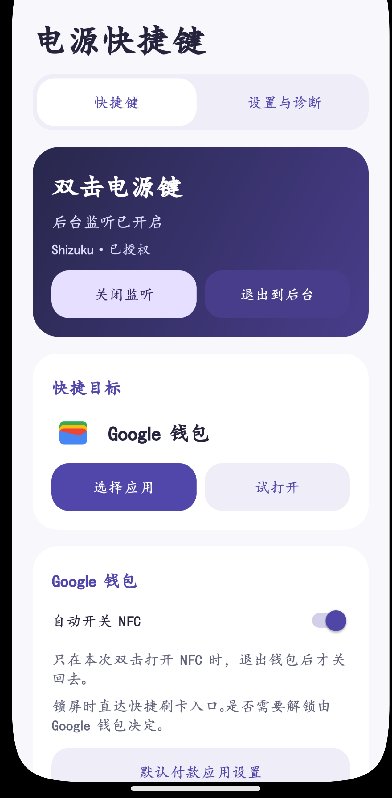

# 电源快捷键 · Shizuku 版

用 Shizuku 在支持的 ColorOS 手机上监听物理电源键双击，打开 Google 钱包快捷刷卡页或其他已安装应用。应用提供 ChatGPT、Gemini 和 Google 钱包预设，支持在后台继续监听。

## 项目初衷

这款工具起于一个日常问题：在国行 ColorOS 上用 Google 钱包时，系统的电源键双击可能唤起原厂钱包。付款前如果要先回桌面、找应用，再手动开 NFC，操作就会被打断。项目希望把这几步收成一个熟悉的动作：双击电源键，准备 NFC 并打开所选应用，用完后恢复这次临时修改的 NFC 状态。

项目优先尝试无需 Root 的 Shizuku 路径。希望减少亮屏双击先息屏的用户，可以单独开启防闪屏；单击依然会息屏，只是会等一个双击判定窗口。Google 钱包的卡片展示和支付验证由钱包与 Android 处理。

## 安装

从 [0.3.0 测试版发布页](https://github.com/zzw8/ColorOS-PowerShortcut/releases/tag/v0.3.0) 下载并安装 APK。完整的 Shizuku 配对、Google 钱包配置、后台使用和故障排查步骤见 [中文图文指南](docs/guide.zh-CN.md)。

**开启插件监听前，请先关闭系统自带的「双击电源键唤起钱包」。** 可以在本应用的「设置与诊断 → 打开原厂钱包」进入 ColorOS 钱包，再到「我的 → 设置」关闭「双击电源键唤起快捷服务」。

首页实拍来自此前的测试版，已裁掉系统状态栏。当前版在 Google 钱包卡片内提供「防止双击先息屏」开关。

## 兼容性

- APK 可安装在 Android 12 及以上。此前在一加 15（PLK110，ColorOS 16.0.7.207 CN01）验证了双击、后台监听和 NFC 切换。其他机型及版本取决于固件日志和系统启动策略。
- 初次监听由用户手动开启，之后会保留开启状态。前台服务可在一般的进程回收后恢复，也会在手机重启后尝试恢复。Shizuku 未启动时，服务等待连接。重新打开应用即可关闭监听。
- 授权并选择目标后，点「退出到后台」会开启或保留监听，关闭界面并移除最近任务卡片。应用界面退出后只阻塞等待按键日志，状态轮询只在打开应用时运行。
- Android 13 及以上无需为本应用授权通知。系统仍可在「正在运行的应用」列表中显示前台服务，Android 12 也可能显示系统要求的常驻通知。
- 「设置与诊断」可查看当前安装的版本号，并切换浅色、深色或跟随系统。外观选择会保存在本机。
- Google 钱包预设默认在第二下松开后提前准备 NFC，并继续等待双击确认。取消候选手势或离开钱包后，会恢复这次临时开启的 NFC。双击前已经开启的 NFC 会保留。系统强行终止 Shizuku 时，自动恢复可能无法执行。
- ColorOS 仍可能限制后台服务。可点「后台运行设置」进入本应用的系统设置，检查后台活动权限。系统的强行停止会中止监听，之后需要重新打开应用。
- OEM 原始双击动作可能先显示。单击、长按、原厂多击和 SOS 的系统分派由固件处理。应用会等候额外一个多击窗口，若收到第三次按下事件则取消应用启动。
- Google 钱包预设中的「防止双击先息屏」默认关闭。开启后，监听期间暂缓亮屏单击的自动休眠，窗口结束仍只有一次按键时补发息屏。单击会多等待系统的双击窗口。关闭选项、关闭监听或监听进程退出时恢复原始息屏设置；设备硬重启后的残留状态会在 Shizuku 重新连接时恢复。
- 本应用无法通过 Shizuku 自动切换原厂钱包的双击开关。若曾在原厂钱包中手动关掉该快捷动作，停用本应用后可在原处重新打开。
- 当前仅实现双击入口。参考项目的电源键长按、手势条长按、底角内滑和一圈即搜依赖系统内部派发，尚未通过 Shizuku 复现。
- 应用没有申请网络权限。它使用经过过滤的系统电源键日志和 Google 钱包窗口事件，应用在内存中处理这些记录。

## 构建

安装 JDK 17 和 Android SDK Platform 35，设置 `JAVA_HOME` 与 `ANDROID_HOME`。Windows 在项目根目录运行 `gradlew.bat assembleDebug`，macOS/Linux 运行 `sh gradlew assembleDebug`。构建结果位于 `app/build/outputs/apk/debug/app-debug.apk`。

## 参考资料

- [ColorOS Power Key Customizer v1.1.7](https://github.com/LusiyAvA/ColorOS-Power-Key-Customizer/tree/v1.1.7-debug) 提供功能参考。
- [ColorOS Power Launcher](https://github.com/Nielk74/coloros-power-button-launcher) 提供 ColorOS 日志标签与按键格式参考，项目为 MIT 许可。
- [Shizuku API](https://github.com/RikkaApps/Shizuku-API) 为应用使用的 MIT 许可库。
