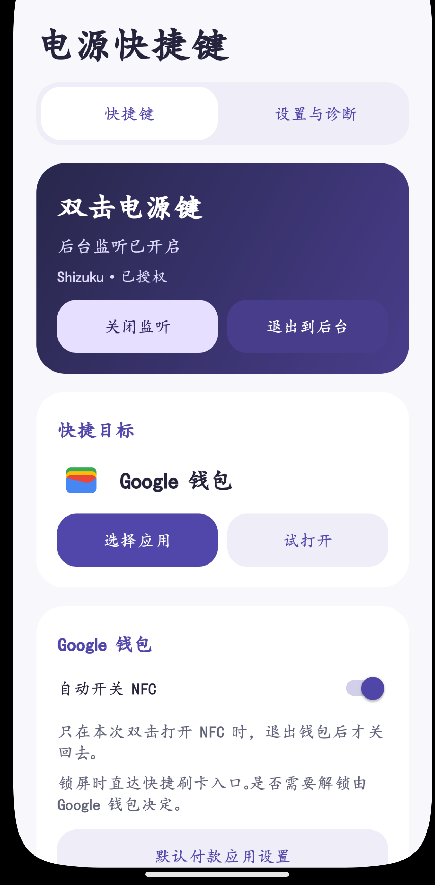
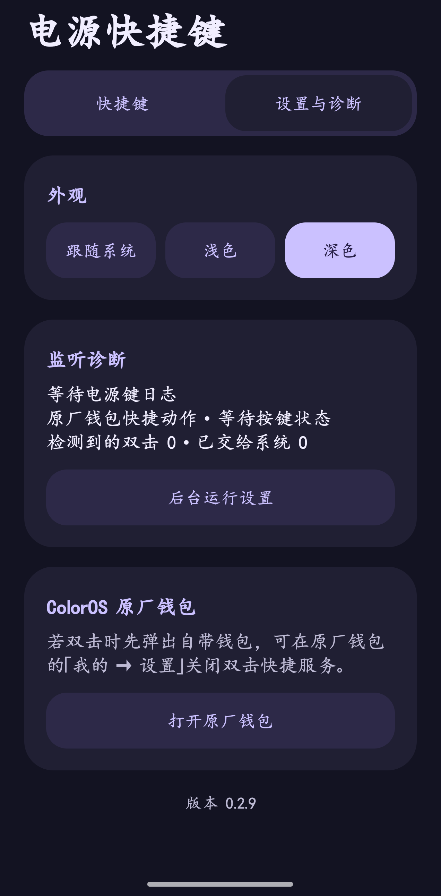

# 电源快捷键使用指南

**开启插件监听前，请先关闭系统自带的「双击电源键唤起钱包」。** 打开 ColorOS 钱包的「我的 → 设置」，关闭「双击电源键唤起快捷服务」。也可以从本应用的「设置与诊断 → 打开原厂钱包」进入。以后停用插件时，可回到原处重新开启。

## 1. 下载并安装

1. 在手机上打开 [电源快捷键 0.3.0 测试版](https://github.com/zzw8/ColorOS-PowerShortcut/releases/tag/v0.3.0)，展开发布页的「Assets」，下载 `PowerShortcut-0.3.0-debug.apk`。
2. 用手机文件管理器打开下载的 APK。若系统提示当前来源无法安装，进入提示页允许本次使用的浏览器或文件管理器安装，再返回安装。安装完可在同一页撤销该来源的权限。
3. 若还没有 Shizuku，安装 [Shizuku 正式版](https://github.com/RikkaApps/Shizuku/releases/latest)。只想打开普通应用时，直接跳过下面的 Google 钱包设置即可。

## 2. 在手机上配对并启动 Shizuku

1. 连接 Wi‑Fi。在 ColorOS 打开「设置 → 关于本机 → 版本信息」，连续点按「版本号」直到提示已进入开发者模式。菜单位置可能因版本而异，在设置中搜索「版本号」也能找到。
2. 在设置中搜索「无线调试」。在开发者选项中开启 USB 调试和无线调试，按系统提示确认。整个无线配对过程可以在手机上完成，无需连电脑。
3. 打开 Shizuku，在「通过无线调试启动」处点「配对」。如果 Android 提示通知权限，允许 Shizuku 显示本次配对通知。
4. 切回系统「无线调试」页面，点「使用配对码配对设备」。下拉通知栏，在 **Shizuku 的配对通知**中输入系统显示的六位配对码，并提交。配对码只在手机上使用。 [Shizuku 官方逐屏图解](https://shizuku.rikka.app/zh-hans/guide/setup/)
5. 回到 Shizuku 点「启动」，等首页显示正在运行。无线配对一般只需做一次。手机重启后如果 Shizuku 停止，回到同一位置点「启动」。
6. 第一次打开「电源快捷键」时点「授权 Shizuku」，在弹窗里允许访问。首页应显示「Shizuku · 已授权」。

## 3. 配置双击打开的应用

首页实拍来自较早的测试版，已裁掉状态栏。新版的 Google 钱包卡片还提供「防止双击先息屏」。

1. 在「快捷键」页找到「快捷目标」，点「选择应用」。
2. 要打开 Google 钱包刷卡页，选列表上方的 **Google 钱包 · 预设**。直接选择普通的 Google 钱包应用条目时，双击打开的是应用的常规入口。要打开其他应用，可以按名称或包名搜索并点选。
3. 点「试打开」确认目标应用能启动。这个按钮只测试应用启动。要测试双击和 NFC 联动，请按下文用物理电源键操作。
4. 确认系统自带的钱包双击快捷服务已经关闭，然后点「开启监听」。如果想关闭界面并留在后台，点「退出到后台」。这个按钮也会在有目标且已授权时开启监听。

## 4. Google 钱包和 NFC 设置

1. 在 Google 钱包添加支持感应支付的卡片，并按钱包提示完成设置。在「电源快捷键 → Google 钱包」卡片点「默认付款应用设置」，在 Android 的 NFC 付款设置中选择 Google 钱包。不同固件也可能把它叫作「Google Pay」。 [Google 钱包感应支付设置](https://support.google.com/wallet/answer/12060043?hl=zh-Hans)
2. 「自动开关 NFC」默认开启。第二下按键松开后，应用会提前准备 NFC，等系统双击窗口结束再打开钱包。原本已经打开的 NFC 会保持开启。应用只在自己临时打开 NFC 的情况下，才会在取消双击或退出钱包后尝试恢复关闭。
3. 关闭原厂快捷服务后，如果亮屏双击时会先闪一下锁屏，在首页的 Google 钱包卡片打开「防止双击先息屏」。开启后单击仍会息屏，只是会先等一个系统双击窗口，一加 15 测试机约为 0.3 秒。关闭开关即可恢复原来的单击时序。

## 5. 验证与日常使用

| 测试 | 操作 | 预期 |
| --- | --- | --- |
| 亮屏双击 | 回到桌面或其他应用，快速按两下物理电源键 | 打开所选应用。若已启用防闪屏，首击应保持亮屏。 |
| 单击 | 保持亮屏，只按一下电源键 | 正常息屏。防闪屏开启时，息屏会稍晚一些。 |
| 锁屏双击 | 锁屏后快速按两下物理电源键 | 请求打开 Google 钱包快捷刷卡页。系统或钱包可能先要求指纹、PIN 或密码，按提示完成验证。 |
| 退出钱包 | 从刷卡页返回桌面或上一应用 | 如 NFC 由本次快捷动作打开，会在确认退出后关闭。 |
| 停止监听 | 打开「电源快捷键」，点「关闭监听」 | 双击监听停止，防闪屏的临时设置会恢复。 |

## 6. 看诊断和反馈问题

上图为较早测试版的实拍，已裁掉状态栏。当前安装版本以页面底部显示为准。

| 看到的情况 | 检查方法 |
| --- | --- |
| Shizuku 未连接 | 打开 Shizuku 确认服务运行。如果「电源快捷键」仍提示未授权，回到首页重新授权。 |
| 一直显示「等待电源键日志」 | 用物理电源键快速双击，再打开「设置与诊断」。不同 ColorOS 固件可能使用不同的按键日志。 |
| 双击计数增加，钱包未打开 | 在首页用「试打开」确认目标可用，再确认选的是 Google 钱包预设。 |
| 原厂钱包也会弹出 | 检查 ColorOS 钱包的「我的 → 设置」，确认「双击电源键唤起快捷服务」已关闭。 |
| 开了钱包，刷卡仍提示 NFC 或卡片设置 | 确认「自动开关 NFC」已开启、系统默认付款应用是 Google 钱包，并查看 Google 钱包中的卡片状态。 |
| 从最近任务划掉后失效 | 先用「退出到后台」测试，再到「设置与诊断 → 后台运行设置」查看 ColorOS 是否限制了后台活动。 |
| 停止后单击仍未恢复 | 关闭「防止双击先息屏」，启动 Shizuku，再开启并关闭一次监听，让服务有机会恢复原始电源键设置。 |

反馈时请附应用版本、机型、ColorOS 完整构建号以及「设置与诊断」状态。截图请裁掉状态栏，并避开银行卡、账户资料、通知内容和无线调试配对码。
